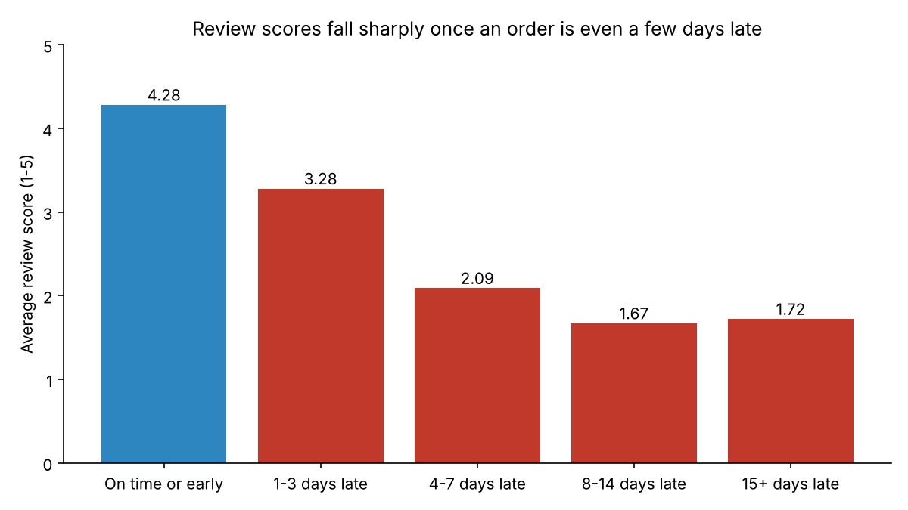
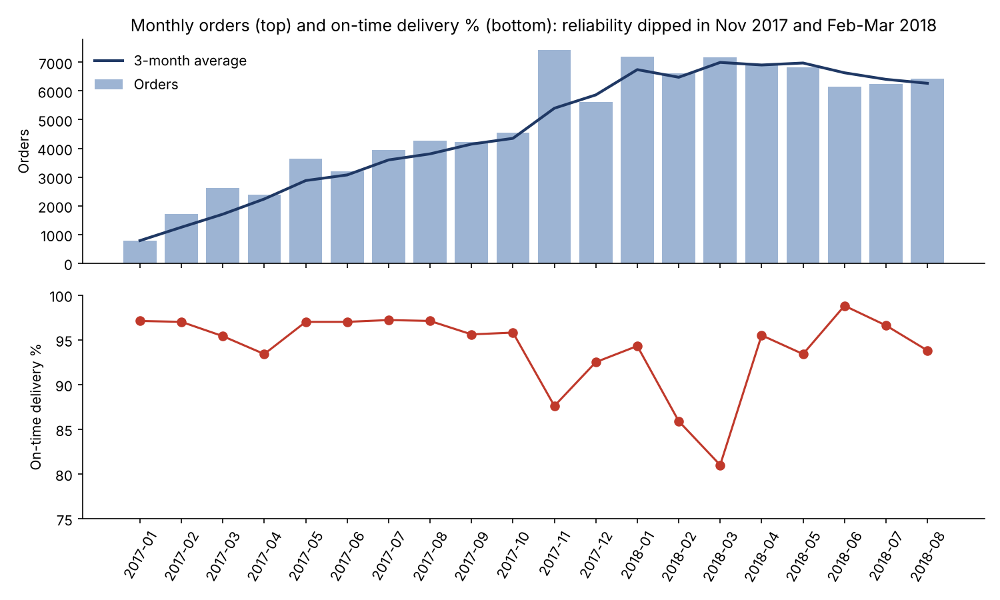

# Supply Chain SQL Analytics: Delivery Reliability, Seller Performance and Demand Planning

SQL analysis of **96,203 real delivered e-commerce orders** (Olist, Brazil, Jan 2017 – Aug 2018) to answer the questions a supply chain or planning team asks every week: Are we keeping our delivery promise? Where and why do orders arrive late? Which suppliers need attention? Which products deserve the most planning effort?

**Tools:** SQL (DuckDB), Python (pandas, matplotlib) · **Data:** public [Olist Brazilian E-Commerce dataset](https://www.kaggle.com/datasets/olistbr/brazilian-ecommerce) (real, anonymized orders)

## Key findings

| # | Finding | Query |
|---|---|---|
| 1 | **On-time delivery was 93.2%**; median lead time from purchase to doorstep was 10 days. | 03 |
| 2 | **Late orders destroy satisfaction.** On-time orders average 4.28 stars; orders 4–7 days late average 2.09, and 68% of their reviews are 1–2 stars (vs 9.5% when on time). | 10 |
| 3 | **Most lateness is in transit, not at the seller.** 72% of late orders were handed to the carrier on time and still missed the promised date. | 12 |
| 4 | **Late orders are concentrated.** 98 sellers (3.3% of 2,945 active sellers) account for half of all late orders. | 07 |
| 5 | **One lane is the biggest problem.** São Paulo → Rio de Janeiro carries 8.4% of orders but 17.6% of late orders (14.1% late vs 4.6% within São Paulo). | 05 |
| 6 | **Reliability broke under peak load.** On-time fell to 87.6% in Nov 2017 (orders +63% month over month) and to 81.0% in Mar 2018. | 02, 03 |
| 7 | **Freight costs are regional.** Freight is 22.7% of item price in the North and 21.7% in the Northeast, vs 15.2% in the Southeast. | 11 |
| 8 | **Planning focus:** 18 of 74 product categories make up 81% of revenue (ABC class A). 8 have steady demand (X), 9 are variable (Y), 1 is erratic (Z). | 08, 09 |



## Recommendations

These are my conclusions from the data above, not results that were implemented.

1. **Fix transit before sellers.** Since 72% of late orders left the seller on time, carrier performance and the delivery-date promise itself are the main levers. Start with the São Paulo → Rio de Janeiro lane.
2. **Run a targeted supplier review.** The seller scorecard (query 06) ranks the 210 highest-volume sellers. Reviewing the 98 sellers behind half of late orders addresses the problem without touching the other 97%.
3. **Pad promise dates before peaks.** On-time delivery dropped in November and in Feb–Mar. Adding buffer to estimated delivery dates in peak months protects review scores (finding 2).
4. **Plan by ABC-XYZ segment.** Automate replenishment for AX categories (high revenue, steady demand), give AY categories more safety stock and planner review, and handle the AZ category (computers) case by case.



## What each query does

| File | Business question | SQL techniques |
|---|---|---|
| `00_load_tables.sql` | Load the data and build a clean view of delivered orders | `CREATE TABLE AS`, `CREATE VIEW`, `DATE_DIFF`, `CASE` |
| `01_data_quality_checks.sql` | Can we trust the data? | `UNION ALL`, `COUNT(DISTINCT)`, null and timestamp checks |
| `02_monthly_demand_trend.sql` | How is demand trending? | CTE, `LAG()`, moving average with `AVG() OVER (ROWS BETWEEN …)` |
| `03_on_time_delivery_by_month.sql` | Are we keeping our delivery promise? | Conditional aggregation |
| `04_lead_time_distribution_by_state.sql` | Which regions wait longest? | `QUANTILE_CONT` (P50/P90), `HAVING` |
| `05_late_delivery_by_lane.sql` | Which lanes produce the most late orders? | Multi-table joins, `SUM(COUNT(*)) OVER ()`, `QUALIFY` |
| `06_seller_scorecard.sql` | Which suppliers should we review first? | Multiple CTEs, `LEFT JOIN`, `RANK()`, `NTILE()` |
| `07_late_order_pareto_by_seller.sql` | Is lateness concentrated? | Running totals with `SUM() OVER (ORDER BY …)`, `ROW_NUMBER()` |
| `08_category_abc_classification.sql` | Which categories drive revenue? | Cumulative share, `CASE` classification |
| `09_category_xyz_demand_variability.sql` | How forecastable is each category? | `CROSS JOIN` to fill zero months, `STDDEV_SAMP`, coefficient of variation |
| `10_late_delivery_vs_review_score.sql` | What does lateness cost in satisfaction? | Bucketing with `CASE`, conditional averages |
| `11_freight_cost_by_region.sql` | Where does freight eat margin? | `VALUES` lookup table, ratio of sums |
| `12_late_root_cause_seller_vs_carrier.sql` | Seller problem or carrier problem? | Order-level flags with `MAX(CASE …)`, share of total |

## How to run it

```bash
pip install -r requirements.txt
python run_all.py
```

The first run downloads the dataset (about 65 MB) into `data/`. The script then runs every query, saves results to `outputs/` as CSV files, saves charts to `charts/`, and writes `outputs/key_findings.md`. Every number in this README comes from that file.

The queries use standard SQL (CTEs, joins, window functions) and run in DuckDB. Most run in PostgreSQL with minor changes (`QUALIFY`, `QUANTILE_CONT` and `DATE_DIFF` are the main DuckDB-specific pieces).

## Definitions and data notes

- **On time:** delivered on or before the estimated delivery date shown to the customer at purchase.
- **Lead time:** days from purchase to delivery.
- **Seller handoff late:** the seller gave the item to the carrier after its own shipping-limit date.
- **ABC:** A = categories making up the first 80% of revenue, B = the next 15%, C = the last 5%.
- **XYZ:** coefficient of variation of monthly units. X < 0.5, Y 0.5–1.0, Z ≥ 1.0.
- **Window:** Jan 2017 – Aug 2018. 2016 and Sep–Oct 2018 have too few orders to analyze reliably.
- **Data quality** (query 01): 8 "delivered" orders have no delivery date and are excluded. 1,359 orders show a carrier handoff timestamp before approval, a known quirk of this dataset; they are kept, but they affect the handoff metrics slightly.

## Data source and license

Olist, *Brazilian E-Commerce Public Dataset by Olist*, published on Kaggle under CC BY-NC-SA 4.0. The data is not stored in this repository; `run_all.py` downloads it. The code in this repository is MIT-licensed.
